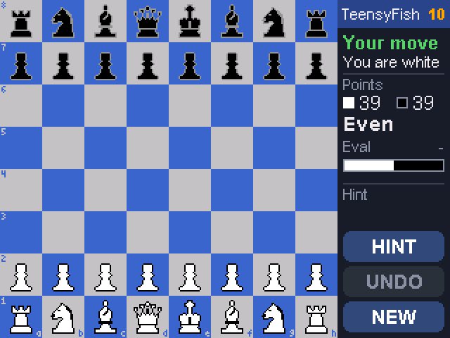
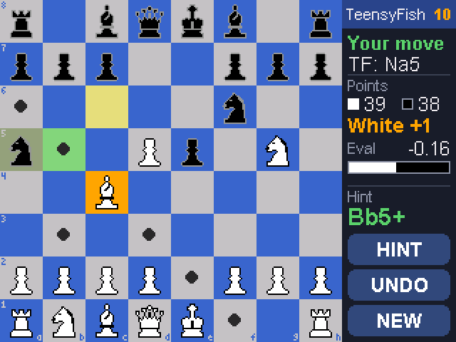
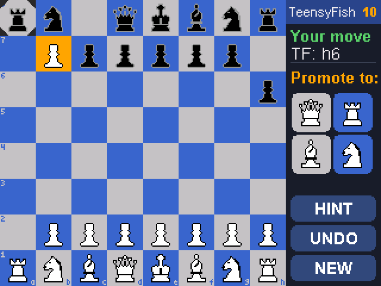
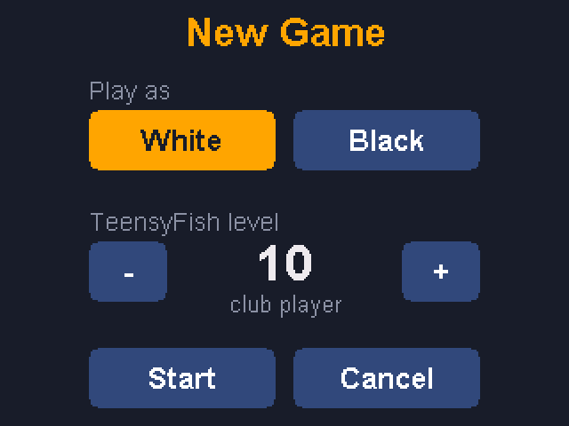

# Teensy Chess

Play chess against **TeensyFish**, a port of the [Stockfish](https://github.com/official-stockfish/Stockfish)
chess engine, on a Teensy 4.0 with a 2.8" ILI9341 touch display. Everything runs on the
Teensy: no PC, no network.

YouTube Video https://youtu.be/XVFergngo14

| Start of a game | A selected piece, the engine's last move and a hint |
|---|---|
|  |  |

| Promotion | New game |
|---|---|
|  |  |

*(Screenshots are rendered on a PC from the sketch's own drawing code, see [UI preview](#ui-preview).)*

## Features

- Stockfish's search, move generation, transposition table and move ordering, ported to
  the Teensy's 600 MHz Cortex-M7
- 21 strength levels (0 = beginner, 20 = full strength), chosen when you start a new game
- Play as white or black (the board flips when you play black)
- Tap a piece to select it (orange); dots show its legal moves; tap a destination to move
- Highlights for the last move (yellow), a king in check (red) and the hint (green)
- Info panel: game status, material points (who is ahead), the engine's evaluation, and
  **HINT**, **UNDO** and **NEW** buttons
- Promotion picker, checkmate / stalemate / 50-move / repetition / insufficient-material
  detection
- Buzzer clicks on accepted taps and on the engine's moves, and a warning beep on illegal
  taps
- Touch calibration, saved in EEPROM together with the last level and colour
- No clocks: take as long as you like

## About the engine

Current Stockfish evaluates positions with an NNUE neural network whose weights are
tens of megabytes, far more than the Teensy's 2 MB of flash. TeensyFish therefore uses
modern Stockfish's search with the **handcrafted evaluation** of Stockfish 11 (the last
version before NNUE), which needs no network. Other changes for the Teensy's 1 MB of RAM:

- Slider attacks with hyperbola quintessence instead of 800 KB magic bitboard tables
- Smaller history tables and a 192 KB transposition table
- A single search thread, maximum search depth 64 plies
- No UCI protocol, opening book or endgame tablebases

Expect strong club-to-expert play at level 20, not the 3500+ Elo of desktop Stockfish.
At level 20 the engine thinks about 3 seconds per move (`500 + level × 125` ms); hints
always use full strength for 2 seconds.

## Hardware

- [Teensy 4.0](https://www.pjrc.com/store/teensy40.html)
- 2.8" 320 × 240 SPI TFT with ILI9341 driver and XPT2046 resistive touch controller
  (the common red-PCB module)
- Passive buzzer (optional)

### Wiring

The display and the touch controller share the hardware SPI bus.

| Module pin | Teensy 4.0 pin |
|---|---|
| VCC | 3.3 V |
| GND | GND |
| CS | 10 |
| RESET | 8 |
| DC | 9 |
| SDI (MOSI) and T_DIN | 11 |
| SDO (MISO) and T_DO | 12 |
| SCK and T_CLK | 13 |
| LED | 3.3 V |
| T_CS | 0 |
| T_IRQ | not connected (the touch panel is polled) |
| Buzzer + / − | 3 / GND |

The pins, colours, buzzer pitch and volume, and engine settings can be changed in
[`TeensyChess/config.h`](TeensyChess/config.h).

## Building

1. Install the [Arduino IDE](https://www.arduino.cc/en/software) and
   [Teensyduino](https://www.pjrc.com/teensy/td_download.html) (tested with 1.62).
2. Install the libraries **ILI9341_t3** and **XPT2046_Touchscreen** by Paul Stoffregen
   (both come with Teensyduino, or get them from GitHub).
3. Open `TeensyChess/TeensyChess.ino`.
4. In the **Tools** menu select:
   - Board: **Teensy 4.0**
   - CPU Speed: **600 MHz**
   - Optimize: **Faster**
   - USB Type: **Serial**
5. Upload.

The sketch uses about 195 KB of flash, and fits the Teensy's two RAM banks with 237 KB
left for the stack.

## Using it

- **First start:** the touch calibration runs automatically. Tap the two crosshairs,
  then draw on the screen to check that the dots follow your finger.
  To recalibrate later, tap the splash screen within 3 seconds of power-up, or send `c`
  over the serial monitor.
- **Moving:** tap one of your pieces, then a destination square. Tap the piece again to
  put it back, or tap another of your pieces to switch. Castle by moving the king two
  squares.
- **HINT** shows the engine's suggested move in the panel and highlights it on the board.
- **UNDO** takes back your last move and the engine's reply.
- **NEW** opens the new game dialog (colour and level).

### Serial monitor (115200 baud)

| Command | Action |
|---|---|
| `p` | Perft self-test of the move generator |
| `b` | Short search benchmark (nodes per second) |
| `f` | Print the current position as FEN |
| `c` | Recalibrate the touch screen |

Each engine move is also logged with its score, depth, nodes and time.

## Repository layout

```
TeensyChess/                The Arduino sketch
  TeensyChess.ino           Main program: game flow, buttons, sounds, serial commands
  config.h                  Wiring, colours, layout and engine settings
  game.*                    The game: position, move history, notation, result
  ui.*                      Drawing the board, the info panel and the dialogs
  touch_input.*             Touch calibration and tap detection
  storage.*                 Settings in EEPROM
  pieces.h                  Piece icons (generated by tools/make_icons.js)
  src/engine/               The Stockfish port (TeensyFish)
tools/
  build.sh                  Command-line build for the Teensy 4.0 (checks size, no upload)
  make_icons.js             Generates pieces.h (and preview.png) from vector drawings
  host_test/                Engine tests that run on a PC
  ui_preview/               Renders the screens to PNG on a PC
```

## Development tools

These are optional and only needed if you change the code. The scripts are bash scripts
for Windows (Git Bash) with the portable [w64devkit](https://github.com/skeeto/w64devkit)
GCC unpacked into `tools/w64devkit/`; on Linux or macOS, adjust the compiler paths.
Set `ARDUINO_LIBS` to your Arduino libraries folder if it is not
`C:\Arduino_Sketches\libraries`.

- **Engine tests:** `bash tools/host_test/run_tests.sh` (debug build with undefined
  behaviour checks) or `bash tools/host_test/run_tests.sh release` (optimized, deeper
  perft). They check move generation against known perft counts, the consistency of
  incremental updates over 80,000+ random positions, evaluation symmetry, mate finding,
  basic endgame conversion and tactics puzzles.
- **Firmware build check:** `bash tools/build.sh` compiles the sketch with the Teensyduino
  toolchain and prints the memory usage.
- <a id="ui-preview"></a>**UI preview:** `bash tools/ui_preview/run_preview.sh` compiles
  the sketch's drawing code against a framebuffer stand-in for the display and writes the
  screens to `tools/ui_preview/out/`.
- **Piece icons:** `node tools/make_icons.js TeensyChess/pieces.h tools/preview.png`

## License

Teensy Chess is free software under the **GNU General Public License v3.0 or later**; see
[LICENSE](LICENSE).

The chess engine in `TeensyChess/src/engine` is derived from Stockfish, Copyright (C)
2004-2026 The Stockfish developers (see [AUTHORS](TeensyChess/src/engine/AUTHORS)), which
is licensed under the GPLv3. As a result the whole program is under the GPLv3. If you
distribute it, or a modified version, including as a compiled `.hex` file or a finished
device, you must make the complete source code available under the same license and keep
the copyright notices.

The ILI9341_t3 and XPT2046_Touchscreen libraries (MIT license, by Paul Stoffregen) are
not included in this repository.

## Credits

- [Stockfish](https://stockfishchess.org/) and its developers, for the engine
- Paul Stoffregen / [PJRC](https://www.pjrc.com/), for the Teensy and the display and
  touch libraries
